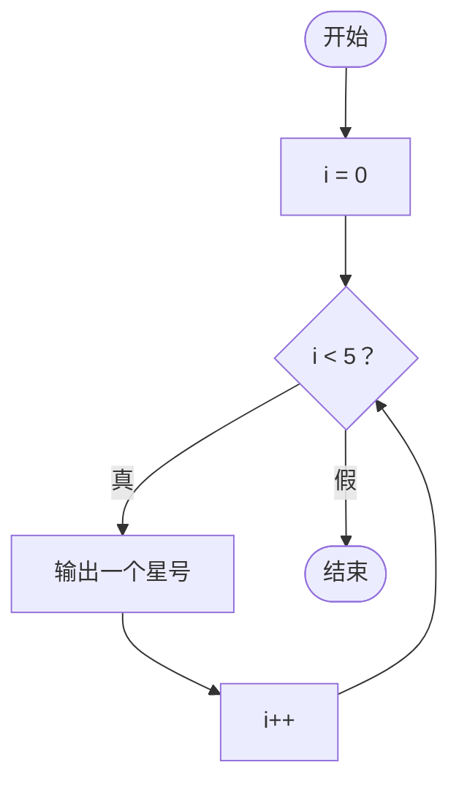

# 014 · 流程图：沿箭头读懂分支与循环

从起点沿箭头走，遇到菱形就读出里面的问题，按答案选择出口。若箭头回到先前的判断，先看这一轮改变了什么，再用新值判断一次。这套读法可以用来梳理排查步骤，也能用来推演 C 程序。

## 一盏不亮的灯，三个可能的去向（00:00–00:42）

讲师在英文维基百科的《Flowchart》词条里放大一张灯具排障图，用粉色笔圈出两个菱形、沿原有箭头描线。起点是“灯不亮”。读图时，先问“插电了吗”，只有回答“是”才需要问灯泡的情况。[课堂所示灯具排障原图](https://commons.wikimedia.org/wiki/File:LampFlowchart.svg)

| 从起点走过的条件 | 图中到达的操作 |
| --- | --- |
| 没插电 | 向右，给灯插上电源。 |
| 已插电，灯泡烧坏了 | 先向下，再向右，更换灯泡。 |
| 已插电，灯泡没烧坏 | 两次向下，检修灯具。 |

讲师用就诊打比方。挂号后先看是否缴费，已缴费就去门诊，未缴费就回家。到医生诊断时又分两路，有病就吃药，没病就回家。他说这些话时，笔尖描的是灯具图上两处判断的出口。

## 一条回到判断框的箭头（00:42–01:17）

讲师放大第二张现成图，依次标出起点、初值、判断、输出和自增，并描出左边返回判断、右边退出的两条线。原声继续用挂号、看病、拍片还需缴费来打比方。图上真正用来决定是否继续的条件是 `i < 5`。[课堂所示 for 循环原图](https://commons.wikimedia.org/wiki/File:For-loop-diagram.svg)

下图按课堂画面重绘，节点文字改为中文供复习。

**按图推演。** 图注给出的循环是 `for (i = 0; i < 5; i++) printf("*");`。初值只设一次。每次条件成立就打印一个星号，再把 `i` 加一。回线指向 `i < 5`，所以依次用 0、1、2、3、4 进入循环体，到 5 时直接结束。条件共判断六次，预计输出 `*****`。五个星号也写在原图的说明中。课堂只在图上描线，没有编译程序或展示控制台输出。[WG14 C11 草案 §6.8.5.3，for 语句的执行顺序](https://www.open-std.org/jtc1/sc22/wg14/www/docs/n1570.pdf#page=169)

## 复习时先看什么（01:17–01:47）

讲师关闭大图，滚过常用符号表，短暂放大了 Flowgorithm 的猜数示例截图，最后回到词条概览。他只在浏览器中看了这张图，没有启动绘图软件。

讲师建议初学者先能说清程序一步一步怎么走。复习这两幅图，可以认出起止框、表示操作的矩形、表示判断的菱形和标明方向的箭头。走到“检修灯具”之前，哪两个判断已经有了答案？循环最后一次回到菱形时，为什么不会多打印一个星号？[课堂浏览的《Flowchart》词条](https://en.wikipedia.org/wiki/Flowchart)
